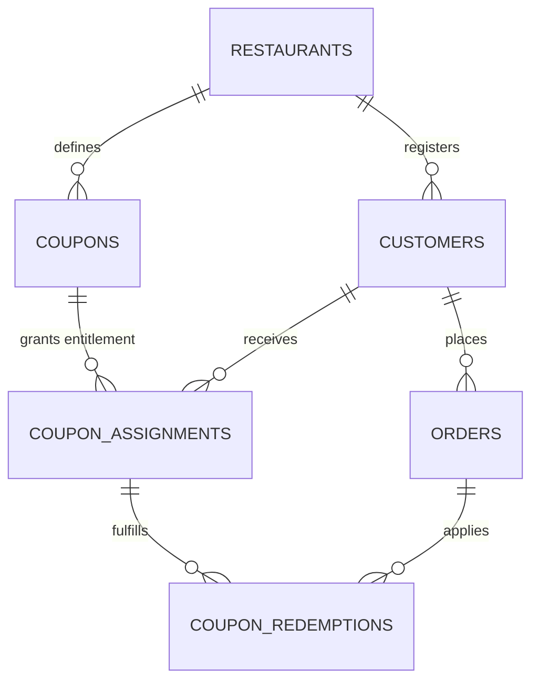
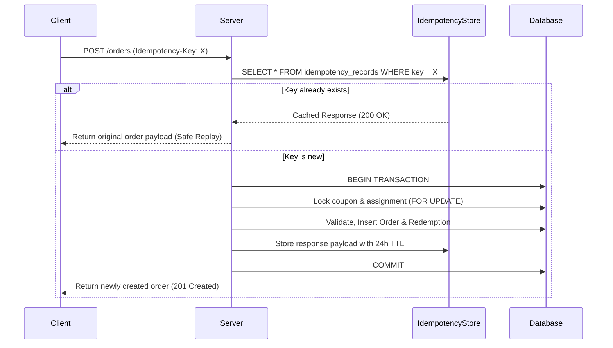

# Architecture Specification: Data Isolation, Customer Identity, and Coupon Integrity

This document defines the architectural standards, security principles, and database contracts governing customer identity, data isolation, coupon distribution, idempotency, and transactional integrity across the Restaurant CRM and Digital Ordering Platform.

---

## 1. Customer Identity Resolution & Authentication Boundaries

### 1.1 Stable Customer UUID
- Every customer record is assigned an immutable, cryptographically secure **UUID** (`customers.id`) as its primary key.
- All relational associations—including orders, coupon assignments, loyalty accounts, and reservations—must reference the customer via this UUID foreign key, never via phone numbers or transient session keys.

### 1.2 Phone Number Normalization (E.164 Standard)
- All mobile phone inputs across the customer ordering menu and administrator CRM are normalized to the **ITU-T E.164 international standard**:
  ```
  [+] [country code] [subscriber number including area code]
  Example (India): +919876543210
  ```
- Normalization is enforced via `normalizeToE164()` in `src/app/core/utils/phone.util.ts` and in the database schema check constraint `chk_customers_phone_e164`.

### 1.3 Uniqueness Scope
- In the multi-tenant architecture, customer phone uniqueness is scoped per restaurant tenant:
  ```sql
  CONSTRAINT uq_restaurant_customer_phone UNIQUE (restaurant_id, phone_e164);
  ```
- This ensures multi-tenant isolation: patron profiles in Restaurant A do not collide with or leak into Restaurant B.

### 1.4 Verified Phone Ownership
> **CRITICAL SECURITY RULE:** A phone number alone is an identifier, **NEVER** an authentication credential.
- Anyone can enter another patron's phone number into a public menu form.
- Production access to private order history, loyalty balances, and stored payment profiles requires **verified ownership**:
  1. The patron requests a short-lived, rate-limited cryptographic OTP challenge (`customer_auth_challenges` table).
  2. The server dispatches the OTP via SMS gateway.
  3. Upon successful verification, the server issues a scoped, signed JWT session token containing `sub: <customer_uuid>` and `role: authenticated_customer`.
  4. Unverified patrons operate in an anonymous guest session with read-only access to the public menu catalog.

---

## 2. Multi-Tenant Data Isolation & Row-Level Security (RLS)

### 2.1 Multi-Tenant Tenant Scoping
- All core tables (`customers`, `orders`, `coupons`, `coupon_assignments`, `coupon_redemptions`, `idempotency_records`, `audit_logs`) carry a mandatory `restaurant_id UUID` foreign key referencing the `restaurants` tenant table.

### 2.2 PostgreSQL Row-Level Security (RLS) Policies
Production access controls are enforced at the database kernel level through Supabase / PostgreSQL Row-Level Security:
```sql
ALTER TABLE customers ENABLE ROW LEVEL SECURITY;
ALTER TABLE orders ENABLE ROW LEVEL SECURITY;
ALTER TABLE coupons ENABLE ROW LEVEL SECURITY;
ALTER TABLE coupon_assignments ENABLE ROW LEVEL SECURITY;
ALTER TABLE coupon_redemptions ENABLE ROW LEVEL SECURITY;
ALTER TABLE audit_logs ENABLE ROW LEVEL SECURITY;
```

#### Access Policy Matrix:
| Table | Public / Anon | Authenticated Patron | Staff / Operations | Admin / Manager |
| :--- | :--- | :--- | :--- | :--- |
| `restaurants` | Active tenant info (`slug`) | Active tenant info | Read-only | Read / Update |
| `customers` | Denied | `auth.uid() = id` (Self only) | Scoped to `restaurant_id` | Full tenant CRUD |
| `orders` | Create via verified table token | `customer_id = auth.uid()` | Live orders for restaurant | Full tenant CRUD |
| `coupons` | Active public coupons (`is_targeted = FALSE`) | Active public coupons | Scoped to `restaurant_id` | Full tenant CRUD |
| `coupon_assignments` | Denied | `customer_id = auth.uid()` (Active only) | Scoped to `restaurant_id` | Full tenant CRUD |
| `coupon_redemptions` | Denied | `customer_id = auth.uid()` | Scoped to `restaurant_id` | Scoped to `restaurant_id` |
| `audit_logs` | Denied | Denied | Denied | Read-only (`restaurant_id`) |

### 2.3 Defense-in-Depth
- Client-side route guards (`adminGuard`), disabled buttons, hidden navigation links, and URL secrecy are treated strictly as **UX conveniences**.
- They are **never** trusted as production security controls. All access decisions are verified by the backend API and database RLS.

---

## 3. Relational Integrity & Three-Way Coupon Decomposition

To prevent race conditions, overuse, and entitlement ambiguity, coupon data is strictly normalized into three relational tables:



### 3.1 `coupons` (Master Campaign Definitions)
- Stores rules, discount formula (`PERCENTAGE` with optional cap, or `FIXED`), validity period (`valid_from` to `valid_until`), minimum spend requirement (`min_order_value`), global usage limit (`total_usage_limit`), and per-customer limit (`per_customer_limit`).
- `is_targeted BOOLEAN`: When `TRUE`, requires an explicit `coupon_assignments` entitlement record for redemption.

### 3.2 `coupon_assignments` (Explicit Customer Entitlements)
- Stores administrator-granted rights for a specific `customer_id` UUID to use a targeted `coupon_id`.
- Tracks:
  - `status`: `'ACTIVE' | 'EXHAUSTED' | 'REVOKED' | 'EXPIRED'`
  - `max_redemptions`: Maximum redemptions granted to this customer.
  - `redemptions_used`: Atomic counter incremented upon each checkout.
  - `assigned_by`: Audit reference to staff member granting the privilege.
- Enforces uniqueness: `UNIQUE (coupon_id, customer_id)`.

### 3.3 `coupon_redemptions` (Immutable Historical Usage Log)
- Created upon successful, finalized order placement.
- Stores `order_id`, `coupon_id`, `assignment_id`, `customer_id`, `discount_amount_applied`, and the `idempotency_key`.
- Enforces single coupon per order: `UNIQUE (order_id)`.
- Enforces single redemption per idempotency key: `UNIQUE (idempotency_key)`.

---

## 4. Server-Authoritative Eligibility & Pricing

### 4.1 Zero-Trust Client Computation
- The browser/client application may calculate estimated totals for responsive UI previews, but the backend server **never** trusts client-supplied discount amounts or eligibility determinations.
- The server independently re-evaluates all conditions inside the database stored procedure `fn_validate_coupon_server_side`:
  1. Campaign active status and date window (`valid_from <= NOW() <= valid_until`).
  2. Order subtotal meets or exceeds `min_order_value`.
  3. Global redemption quota has not been exceeded (`redemption_count < total_usage_limit`).
  4. If `is_targeted = TRUE`: active `coupon_assignments` record exists with `redemptions_used < max_redemptions`.
  5. Individual customer usage does not exceed `per_customer_limit`.
  6. Computes authoritative discount value applying percentage formulas and maximum discount caps.

---

## 5. Idempotency Key Architecture

### 5.1 Retry Safety for Critical Operations
- Order creation and coupon redemption are retry-sensitive. Network timeouts or user double-taps must never result in duplicate orders or double coupon consumption.
- The client generates an RFC 4122 v4 UUID or scoped idempotency token (`idemp_order_<ts>_<rand>`) and attaches it in the HTTP header `X-Idempotency-Key` or payload `idempotency_key`.

### 5.2 De-duplication Workflow


### 5.3 Retention Policy
- Idempotency records are persisted in `idempotency_records` with an `expires_at` timestamp (default: **24 hours** from creation).
- An automated cleanup job (`pg_cron`) purges expired keys daily:
  ```sql
  DELETE FROM idempotency_records WHERE expires_at < NOW();
  ```

---

## 6. Concurrency Control & Database Atomicity

### 6.1 Row-Level Locking (`SELECT ... FOR UPDATE`)
- When two concurrent requests attempt to redeem the last available coupon or entitlement simultaneously, optimistic checking creates race conditions.
- The PostgreSQL transaction acquires exclusive row-level locks on the coupon campaign and entitlement record:
  ```sql
  SELECT * FROM coupons WHERE id = p_coupon_id FOR UPDATE;
  SELECT * FROM coupon_assignments WHERE id = p_assignment_id FOR UPDATE;
  ```
- This serializes concurrent checkout requests on the same coupon. The second request immediately detects that `redemption_count >= total_usage_limit` and is rejected cleanly without overdraft.

### 6.2 Atomic Transactions
- Order insertion, line items insertion, coupon redemption recording, quota increments, and audit log generation are executed within a **single database transaction**.
- If any validation or constraint fails, the entire transaction rolls back cleanly with zero orphaned records.

---

## 7. Auditability & Non-Repudiation

### 7.1 Immutable Audit Log Table (`audit_logs`)
- All sensitive operations record an immutable log entry:
  - `actor_role`: `'CUSTOMER' | 'STAFF' | 'ADMIN' | 'SYSTEM'`
  - `actor_id`: UUID of the performing entity.
  - `action`: Specific operation (e.g. `'COUPON_ASSIGNED'`, `'COUPON_REVOKED'`, `'ORDER_CREATED'`).
  - `entity_type` and `entity_id`: Target resource reference.
  - `payload_before` & `payload_after`: JSONB snapshots capturing state delta.
  - `timestamp`: UTC timestamp generated by database `NOW()`.
- Audit logs are append-only. No `UPDATE` or `DELETE` operations are granted on the `audit_logs` table.

---

## 8. Customer Privacy & PII Protection

### 8.1 Privacy Masking
- Phone numbers and email addresses are personal identifiable information (PII).
- Public-facing views, operational dashboards, and customer-facing order drawers display masked formats:
  - Example: `+91 98765 43210` -> `+91 98*** **210`.
- Masking is performed via `maskPhone()` in `src/app/core/utils/phone.util.ts`.

### 8.2 URL & Logging Sanitation
- Customer phone numbers, auth secrets, and full names are **strictly prohibited** from URL path segments, query parameters, or client-side telemetry logs.
- Resources are addressed exclusively via opaque UUIDs or table tokens.

---

## 9. Frontend Mock Phase vs. Backend Production State

| Architectural Layer | Frontend Mock Phase (Current) | Supabase / Backend Target (Production) |
| :--- | :--- | :--- |
| **Identity Resolution** | UUID model + local simulation | Supabase Auth + PostgreSQL `customers` table |
| **Phone Ownership** | Simulated patron lookup | Twilio / Supabase OTP verification SMS challenge |
| **Data Isolation** | Client-side Angular service filtering | PostgreSQL Row-Level Security (RLS) policies |
| **Coupon Validation** | `MockDataService.simulateServerCouponValidation` | PL/pgSQL stored procedure `fn_validate_coupon_server_side` |
| **Concurrency Locks** | JavaScript single-threaded event loop | PostgreSQL `SELECT FOR UPDATE` row locks |
| **Idempotency** | In-memory / `localStorage` key store | PostgreSQL `idempotency_records` table with TTL index |
| **Audit Trail** | `MockDataService.auditLogs` signal | Write-only `audit_logs` table with DB triggers |

All frontend simulation methods are explicitly marked with `/* [NON-SECURE CLIENT-SIDE SIMULATION] */` comments to prevent production confusion.
