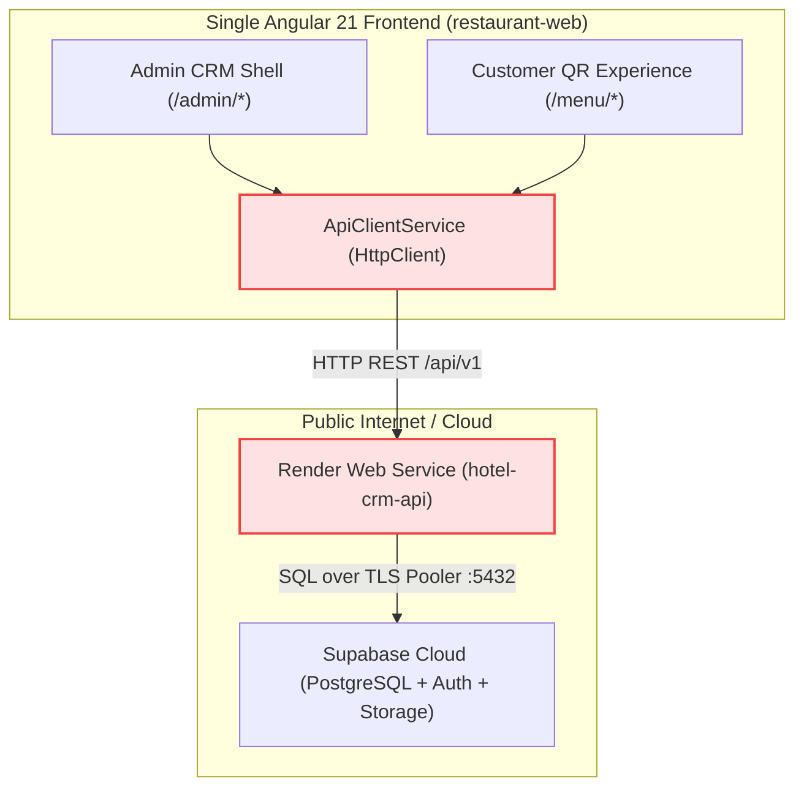
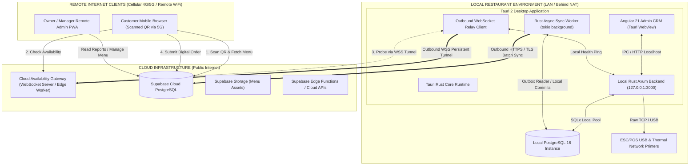
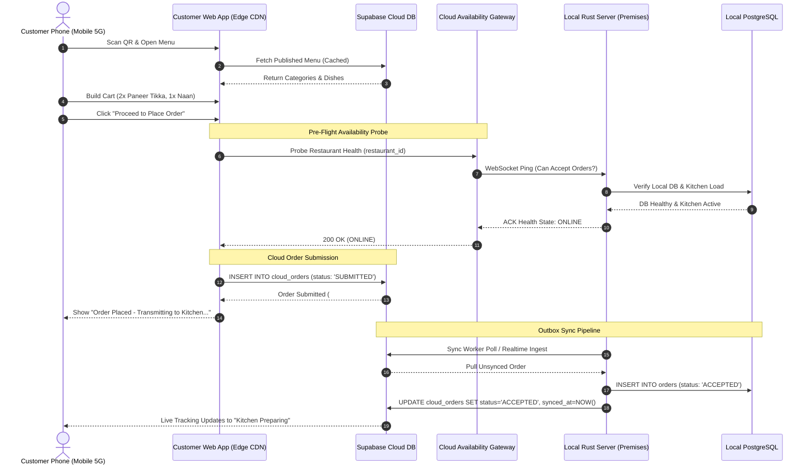
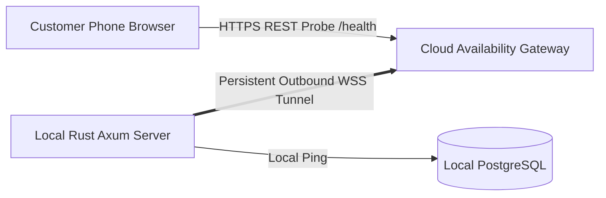
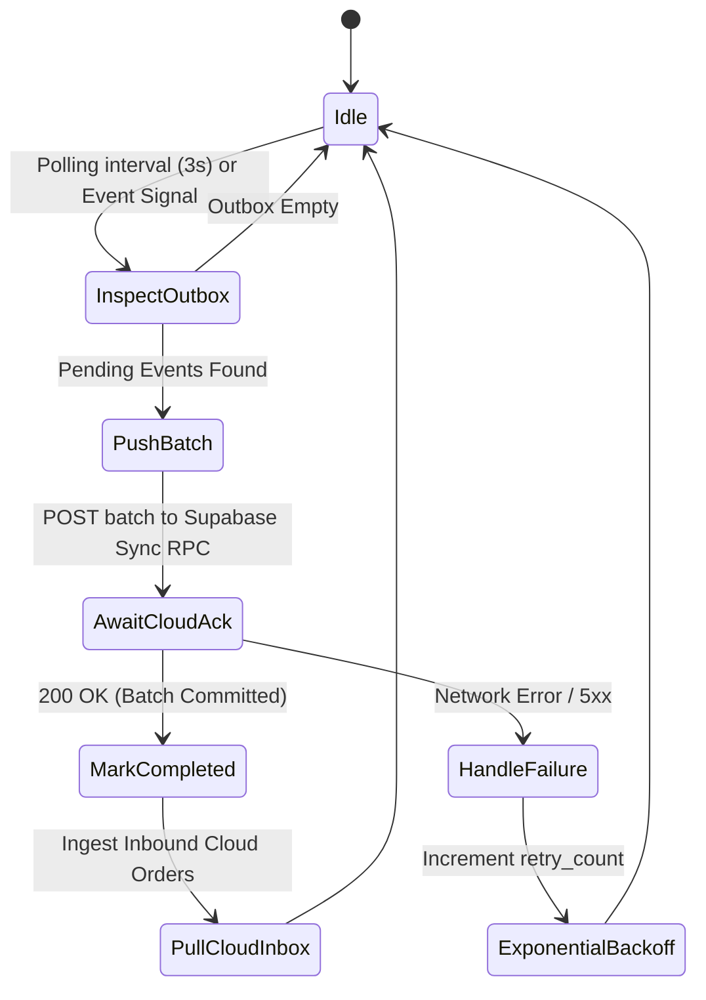
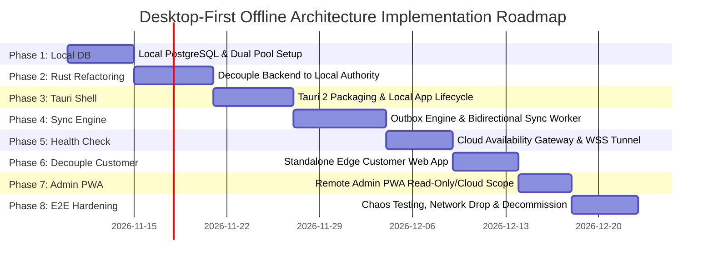
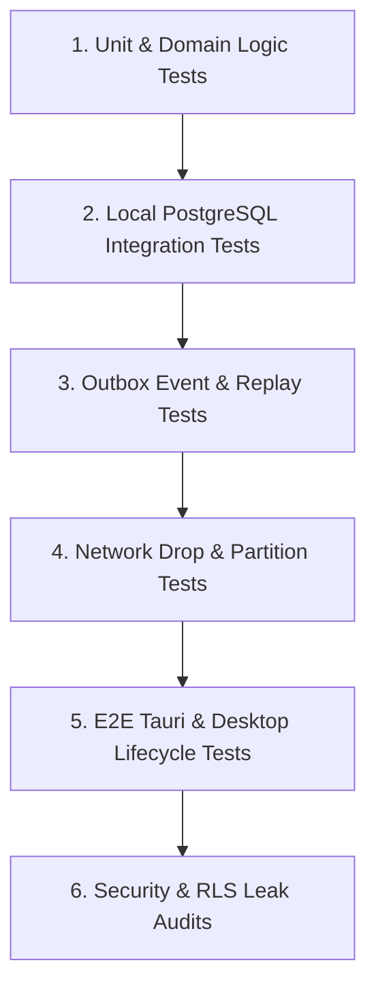

# HOTEL_CRM: Desktop-First Offline Architecture
## Existing System Analysis & Implementation Planning Document

---

## Document Metadata
- **Document Type**: Comprehensive Architectural Blueprint & Implementation Plan
- **Status**: DRAFT / PENDING REVIEW (PLANNING ONLY)
- **Author**: Senior Software Architect, Staff-Level Full-Stack Engineer, Database Architect & Infrastructure Engineer
- **Target Repository**: `HOTEL_CRM`
- **File Location**: `docs/architecture/DESKTOP_FIRST_OFFLINE_ARCHITECTURE_IMPLEMENTATION_PLAN.md`
- **Target Systems**: Tauri 2 Desktop Shell, Rust Axum Core, Angular 21 Client, Local PostgreSQL 16, Supabase Cloud (PostgreSQL 15+, Auth, Realtime, Storage, Edge Functions)

---

# A. Executive Summary

### Existing System Architecture
`HOTEL_CRM` is currently structured as a monolithic monorepo comprising:
1. A **single Angular 21 SPA** (`frontend/restaurant-web`) bundling both the authenticated administrative CRM (`/admin/*`) and the public customer mobile QR menu (`/menu/*`).
2. A **cloud-dependent Rust Axum backend** (`backend/api`) configured via `DATABASE_URL` to connect exclusively across the public internet to a remote Supabase PostgreSQL instance (`aws-0-ap-northeast-2.pooler.supabase.com:5432`).
3. A **single Render Web Service** (`render.yaml`) hosting the Rust API in the cloud.

If the restaurant loses internet connectivity, the local administration CRM and kitchen dispatch boards fail completely because the local Rust API cannot reach the cloud database.

### Proposed Architecture
We are transitioning to a **Desktop-First, Offline-First Restaurant Management Architecture**:
- **Primary Operational Core (The Desktop App)**: Packaged via **Tauri 2** embedding the Angular Admin CRM frontend, a locally spawned or embedded **Rust Axum backend**, and a **Local PostgreSQL database**. All floor operations (POS billing, order dispatch, kitchen tickets, split payments, inventory deduction, and staff attendance) execute against Local PostgreSQL with strict ACID guarantees and zero latency, running 100% offline indefinitely without internet connectivity.
- **Transactional Cloud Synchronization Engine**: An asynchronous background Rust synchronization worker utilizing the **Transactional Outbox Pattern** locally and a corresponding Cloud Inbox/Outbox in Supabase. Operational changes are committed locally first, queued as immutable event records, and synchronized when internet connectivity is active.
- **Decoupled Cloud Customer QR Experience**: A lightweight, standalone web application deployed directly on global cloud edge infrastructure (e.g. Supabase Edge / Cloudflare Pages / Vercel / Render Static). Customers scanning physical QR codes over mobile data (4G/5G) fetch menu catalogs directly from Supabase CDN projections and submit digital orders into a Cloud Orders Inbox.
- **On-Demand Restaurant Health Check Gateway**: Replaces battery-draining continuous heartbeats with an event-driven, on-demand availability probe. Because the restaurant's desktop system is behind a private NAT/LAN router and customers are on cellular mobile data, direct peer-to-peer browser-to-desktop HTTP requests fail. A persistent, secure outbound WebSocket connection from the local Rust server to a Cloud Gateway mediates instantaneous availability checks before customers submit digital orders.
- **Optional Admin PWA**: A remote web management shell accessing Supabase and the Cloud API for read-heavy operations (remote revenue dashboards, reports, and customer directories) and non-conflicting master administrative tasks (e.g., menu adjustments).

### Architectural Benefits
- **Zero Local Downtime**: ISP dropouts, cable cuts, or cloud outages never interrupt order taking, kitchen prep, or bill printing.
- **Instantaneous POS Latency**: Querying localhost PostgreSQL eliminates 100ms–800ms internet roundtrip latency on rapid cashier operations.
- **Drastic Cloud Cost Reduction**: Shifting all intensive operational queries, table status polling, stock decrementing, and report aggregations to local hardware eliminates the need for expensive high-tier compute on cloud hosts (such as Render).
- **Hardened Customer Security**: Eliminates the current critical vulnerability where the Supabase `service_role` key was bundled into public frontend client code.

### Architectural Risks & Mitigations
- **Dual-Database Split-Brain**: Mitigated by strict single-owner domain boundaries (Local is authoritative for orders, stock, and bills; Cloud is authoritative for digital customer cart submissions and published menus).
- **Sync Conflict on Concurrent Edits**: Handled via monotonic revision vectors and domain-level merge rules (e.g., floor cashier edits always override remote PWA edits on active tables).
- **NAT Traversal Failure for Customer Ordering**: Resolved via proactive WebSocket relay with automatic fallback to clear manual-ordering UX ("Show order to staff") if the gateway ping fails.

---

# B. Existing System Architecture

### 1. High-Level Component Topology


### 2. Concrete File-Level Discoveries
1. **Frontend Architecture (`frontend/restaurant-web`)**:
   - `src/app/app.routes.ts`: Unified routing file containing both `/admin/*` (guarded by `adminGuard`) and `/menu/:restaurantSlug/*` (customer mobile flow).
   - `src/environments/environment.ts` & `environment.prod.ts`: Configured with `apiBaseUrl: 'http://localhost:3000/api/v1'` (dev) and `'/api/v1'` (prod). Both files currently leak the Supabase `service_role` key inside `supabaseAnonKey`.
   - `src/app/data-access/services/restaurant-data.service.ts`: Primary Angular service maintaining signals (`orders`, `tables`, `menuItems`, `stockMovements`). Merges HTTP calls to Rust with fallback `localStorage` caching and cross-tab `BroadcastChannel` synchronization.
   - `src/app/data-access/api/api-client.service.ts`: Central HTTP client injecting `x-restaurant-id` and Bearer JWT tokens.
2. **Backend Architecture (`backend/api`)**:
   - Implemented in **Rust using Axum 0.7** and **SQLx 0.7**.
   - `src/main.rs`: Entry point listening on `0.0.0.0:3000` (or `PORT` from environment). Performs startup migration/seed checks and binds routes.
   - `src/config.rs`: Reads `DATABASE_URL`, `SUPABASE_JWT_SECRET`, `SUPABASE_URL`, `ALLOW_DEV_AUTH`.
   - `src/auth/middleware.rs`: Decodes Supabase JWT tokens; supports local dev bypass headers (`x-dev-user-id`, `x-dev-role`) when `ALLOW_DEV_AUTH=true`.
   - `src/routes/`: Route modules for `auth`, `billing`, `coupon`, `customer`, `health`, `inventory`, `menu`, `order`, `reports`, `restaurant`, and `table`.
   - `src/repositories/`: Implements domain data access using SQLx transactions against PostgreSQL.
3. **Database Architecture (`supabase/migrations/`)**:
   - `20261027000001_core_schema.sql`: Core tables (`restaurants`, `tables`, `customers`, `menu_categories`, `menu_items`, `orders`, `order_items`).
   - `20261027000002_billing_and_payments.sql`: `split_bills`, `payments`, `refunds`, `invoices`.
   - `20261027000003_inventory_and_recipes.sql`: `inventory_items`, `recipes`, `recipe_ingredients`, `stock_movements`, `wastage_records`.
   - `20261027000004_coupons_and_reservations.sql`: `coupons`, `coupon_redemptions`, `reservations`.
   - `20261027000005_rls_and_functions.sql`: Row Level Security policies and helper stored procedures.
   - `supabase/patch_migrations.sql`: Non-destructive schema updates adjusting integer paise columns and string status mappings.

---

# C. Current Implementation Audit

| Domain / Feature | Existing Source Implementation | Current Status | Required Architectural Changes |
|---|---|---|---|
| **Desktop Shell** | None (No Tauri config or Rust desktop runner exists) | Missing | Initialize **Tauri 2** workspace (`src-tauri`), configure window lifecycle, deep links, native thermal printer access, and local process management. |
| **Local Database** | None (Backend connects directly to remote Supabase pooler) | Missing | Provision Local PostgreSQL 16 instance. Configure local connection pool in Rust. Add local schema setup and outbox tables. |
| **Rust API Core** | `backend/api/` (Axum 0.7 + SQLx 0.7) | Implemented (Cloud-tied) | Decouple from remote Supabase dependency. Point primary pool to Local PostgreSQL. Add secondary pool/client for cloud sync worker. |
| **Admin CRM Frontend** | `frontend/restaurant-web/src/app/features/admin/` | Completed (Angular 21) | Adapt into desktop webview container. Remove raw Supabase service keys. Add sync status and offline connectivity indicators. |
| **Admin PWA** | Bundled inside `restaurant-web`, no Service Worker | Incomplete | Add `@angular/pwa` / `ngsw-config.json`. Decouple operational POS from remote PWA; restrict PWA to cloud-safe admin features. |
| **Customer QR Website** | `src/app/features/customer/` (Bundled in admin Angular build) | Coupled to Admin SPA | Decouple into independent lightweight web distribution deployed on edge CDN. Direct menu reads from Supabase; digital order submissions to Cloud Inbox. |
| **Data Synchronization** | `localStorage` + cross-tab `BroadcastChannel` in browser | Ephemeral (Client-only) | Build production-grade **Rust Background Synchronization Worker** using the **Transactional Outbox Pattern** with exponential backoff and replay protection. |
| **Health Check & Ping** | `backend/api/src/routes/health.rs` (`/health/live`, `/health/ready`) | Local HTTP only | Build **Outbound WebSocket Cloud Relay** between local Rust and Cloud Gateway to allow remote mobile customers to probe restaurant availability across NAT/firewalls. |
| **POS Billing & Settle** | `billing_repo.rs`, `order-queue.component.ts` | Completed | Route billing and cash/UPI settlement strictly to Local PostgreSQL. Propagate completed receipts asynchronously to Supabase. |
| **Inventory & Recipes** | `inventory_repo.rs`, `inventory.component.ts` | Completed | Local PostgreSQL is single source of truth for stock levels and wastage. Batch-sync stock aggregates to cloud. |
| **Table & QR System** | `table_repo.rs`, `table-list.component.ts` | Completed | Local DB owns table status (`AVAILABLE`, `OCCUPIED`, `DIRTY`). Publish table metadata and cryptographic QR verification tokens to Supabase. |
| **Security & Auth** | Supabase JWT decode, dev header fallback in `middleware.rs` | Functional with Key Leak | Revoke exposed service-role key. Restrict client to Supabase Anon Key + RLS. Implement mutual HMAC authentication for sync and gateway tunnels. |

---

# D. Target Architecture



### Architectural Principles of the Target State:
1. **Zero Cloud Requirement for In-House Dining**: A waiter taking an order at Table 4 or a cashier settling a bill operates exclusively against `Tauri -> Local Axum -> Local PostgreSQL`. Even if the fiber/broadband connection is down, printing, kitchen dispatch, and payment recording proceed without delay.
2. **Outbound-Only Local Connections**: The local system never opens incoming firewall ports and requires no static IP or dynamic DNS. Both the Sync Worker and the Health Gateway establish outbound TLS connections (`443`) to the cloud.
3. **Decoupled Customer Ordering**: Customers browse the menu via Supabase static caching. When submitting an order, the customer's phone queries the Cloud Gateway. If the local desktop is connected, the order is registered in Supabase and ingested by the local sync worker; if disconnected, the order is declined digitally and redirected to manual staff placement.

---

# E. Database Ownership and Data Flow

Indiscriminate two-way synchronization creates split-brain states and race conditions. Therefore, strict domain ownership is enforced:

### Entity Ownership Matrix

| Domain / Entity | Authoritative Owner | Secondary Replica | Sync Flow | Trigger & Frequency | Conflict Resolution Rule | Deletion Policy |
|---|---|---|---|---|---|---|
| **Menu Items & Categories** | **Local Desktop CRM** | Supabase Cloud | Local → Cloud | On save / publish; immediate outbox dispatch | Local Always Wins (Local CRM is source of truth) | Soft delete (`is_active = false`) propagated to cloud |
| **Published Menu Projection** | **Supabase Cloud** | Customer Web CDN | Local → Cloud Projection | On explicit "Publish Menu" click | Atomic cloud table replacement / version tag bump | Cache invalidation via version tag |
| **Dining Tables & QR Tokens** | **Local Desktop CRM** | Supabase Cloud | Local → Cloud | On table layout change / QR token regeneration | Local Always Wins | Soft delete (`is_deleted = true`) |
| **Table Live State** (`OCCUPIED`, `AVAILABLE`) | **Local Desktop CRM** | Supabase Cloud | Local → Cloud | Real-time status advancement event | Local Always Wins (Cloud is read-only for PWA) | State reset on table release |
| **Counter / Takeaway Orders** | **Local Desktop CRM** | Supabase Cloud | Local → Cloud | On order placement in local POS | Local Always Wins | Cancellations recorded as state transitions |
| **Customer QR Digital Orders** | **Cloud Ordering (Customer Phone)** | Local Desktop CRM | Cloud → Local | Immediate via Cloud Outbox + Local Sync Ingestion | Cloud creates `PENDING_SYNC`; Local updates to `ACCEPTED` or `REJECTED` | Cannot be deleted; status transitions only |
| **Bills, Payments & Settlement** | **Local Desktop CRM** | Supabase Cloud | Local → Cloud | On settlement completion | Local Always Wins; financial records immutable | No deletions; credit note / refund entries only |
| **Refunds & Adjustments** | **Local Desktop CRM** | Supabase Cloud | Local → Cloud | On manager authorization | Local Always Wins | Immutable audit log |
| **Inventory & Stock Counts** | **Local Desktop CRM** | Supabase Cloud | Local → Cloud | Periodic batch (every 5 mins or shift close) | Local Always Wins | Soft delete |
| **Staff Members & Attendance** | **Local Desktop CRM** | Supabase Cloud | Local → Cloud | On punch-in/out & profile save | Local Always Wins | Soft delete |
| **Customer Profiles & Feedback** | **Shared (Hybrid)** | Shared | Bidirectional | Asynchronous event sync | Phone number matches; cloud feedback appended to local profile | GDPR / Customer request erasure protocol |
| **Coupons & Redemptions** | **Local Desktop CRM** (Master Rules) | Supabase Cloud (Redemption Ledger) | Bidirectional | Rules: Local → Cloud; Redemptions: Cloud ↔ Local | Cloud enforces single-use locks; Local confirms final settlement | Soft disable (`is_active = false`) |

---

# F. Customer QR Ordering Design

### 1. QR Code Specification & Cryptographic Verification
- Each dining table features an encoded URL: `https://order.restaurantdomain.com/menu/gurukripa-dhaba/table/{tableToken}`
- `tableToken` is not an easily guessable integer. It is a cryptographic, rotating token containing:
  ```json
  {
    "restaurant_id": "00000000-0000-0000-0000-000000000001",
    "table_id": "11111111-0000-0000-0000-000000000001",
    "table_number": "T-04",
    "issued_at": 1731000000,
    "sig": "hmac_sha256(restaurant_id + table_id + issued_at, secret)"
  }
  ```
- Prevents malicious users from tampering with URL parameters to place bogus orders for adjacent tables.

### 2. End-to-End Customer Order Placement Lifecycle



### 3. Graceful Offline Fallback Workflow
When the pre-flight availability probe fails (desktop app closed, power outage, or restaurant broadband severed):
1. The Cloud Gateway returns status `UNREACHABLE` or times out after **1500ms**.
2. Digital order submission is immediately locked in the customer UI.
3. The customer website displays a high-visibility modal and sticky banner:
   > **Restaurant System Offline for Digital Ordering**
   > *Your cart is saved on your phone. Because our local kitchen system cannot be reached right now, please show this screen to your server to place your order manually.*
4. The screen transforms into a large, easy-to-read **Digital KOT Summary**:
   - Table Number: **Table 04**
   - Items: **2x Paneer Butter Masala, 3x Butter Roti**
   - Guest Name & Phone
5. The floor staff member copies or accepts the order directly into the desktop POS interface as a manual walk-in order.
6. **No "zombie" digital orders are left pending in cloud limbo.**

---

# G. On-Demand Health Check Design

### Why Direct Browser-to-Desktop Communication Fails
```
[Customer Mobile Phone (Carrier 5G / CGNAT)]
                   │
                   ▼ (HTTP GET to 192.168.1.50:3000)
       ❌ BLOCKED AT ROUTER / NAT FIREWALL
                   │
[Restaurant Local WiFi Router (Private Subnet)]
                   │
[Local Restaurant PC (192.168.1.50)]
```
- **Private RFC 1918 Address Space**: The restaurant PC has an internal IP (e.g. `192.168.1.50`) invisible to cellular networks.
- **Carrier-Grade NAT (CGNAT)**: Mobile phones do not share a layer-2 or layer-3 route with the restaurant's local network.
- **Mixed-Content Browser Security**: An HTTPS customer website (`https://order.domain.com`) is blocked by modern mobile browsers from making HTTP calls to local subnets (`http://192.168.x.x`).

### Cloud Gateway Architecture


1. **Outbound Tunnel Initialization**:
   - When the Tauri desktop app launches, its embedded Rust process opens an outbound secure WebSocket connection:
     `wss://gateway.hotelcrm.cloud/ws/v1/restaurants/{restaurant_id}`
   - Authenticated using a pre-shared private key (`restaurant_gateway_secret`) established during restaurant provisioning.
2. **Health Probe Protocol**:
   - Customer phone sends HTTPS `GET /api/v1/restaurants/{restaurant_id}/live-status` to Cloud Gateway.
   - Cloud Gateway creates a correlation ID (`probe_uuid`) and sends `{ "type": "HEALTH_CHECK_REQ", "probe_id": "..." }` down the WebSocket tunnel.
   - Local Rust server runs:
     - `SELECT 1` on Local PostgreSQL.
     - System resource verification (disk space, kitchen queue size).
   - Local Rust responds over WebSocket:
     ```json
     {
       "type": "HEALTH_CHECK_RESP",
       "probe_id": "probe_uuid",
       "status": "ONLINE",
       "latency_ms": 12,
       "active_kitchen_queue": 4,
       "digital_ordering_enabled": true
     }
     ```
   - Cloud Gateway returns HTTP 200 to Customer Phone within `< 300ms`.
3. **Availability States**:
   - `ONLINE`: Tunnel connected, local database responding, digital ordering enabled.
   - `DEGRADED`: Tunnel connected, but kitchen queue saturated or non-fatal warning; digital ordering may throttle or advise higher wait times.
   - `UNREACHABLE`: No active WebSocket connection from restaurant premises (desktop closed or internet down). Digital ordering disabled.
   - `UNKNOWN`: Probe timed out (> 1500ms). Digital ordering disabled with retry prompt.

---

# H. Synchronization Design

### 1. Transactional Outbox Pattern
Every state change occurring on the local desktop writes to both the operational table and a local `sync_outbox` table within the **same local PostgreSQL transaction**:

```sql
-- Local Outbox Table Schema
CREATE TABLE IF NOT EXISTS sync_outbox (
    event_id UUID PRIMARY KEY DEFAULT gen_random_uuid(),
    aggregate_type VARCHAR(50) NOT NULL,    -- 'order', 'payment', 'inventory', 'table'
    aggregate_id UUID NOT NULL,
    event_type VARCHAR(50) NOT NULL,        -- 'ORDER_CREATED', 'PAYMENT_SETTLED', 'STOCK_WASTED'
    payload JSONB NOT NULL,
    version INT NOT NULL DEFAULT 1,
    idempotency_key VARCHAR(100) NOT NULL UNIQUE,
    status VARCHAR(20) NOT NULL DEFAULT 'PENDING', -- 'PENDING', 'IN_FLIGHT', 'COMPLETED', 'FAILED'
    retry_count INT NOT NULL DEFAULT 0,
    last_error TEXT,
    created_at TIMESTAMPTZ NOT NULL DEFAULT NOW(),
    synced_at TIMESTAMPTZ
);
CREATE INDEX IF NOT EXISTS idx_sync_outbox_pending ON sync_outbox(status, created_at);
```

### 2. Rust Background Synchronization Worker Lifecycle


### 3. Idempotency & Conflict Handling Rules
1. **Idempotency**: Every event contains an `idempotency_key` (e.g. `pay-settle-{payment_id}`). Supabase cloud ingestion handlers execute `INSERT ... ON CONFLICT (idempotency_key) DO NOTHING`, ensuring duplicate deliveries over patchy internet connections never double-charge or duplicate records.
2. **Cloud Inbox Ingestion**:
   - Digital orders submitted by customers land in Supabase `cloud_orders`.
   - Local sync worker pulls records where `synced_to_local = false`.
   - Local worker commits the order into Local PostgreSQL and confirms back to Supabase.
3. **Partition Reconciliation**:
   - If the restaurant runs offline for 48 hours, all bills, payments, and stock movements accumulate locally in `sync_outbox`.
   - When connection restores, the worker syncs sequentially in ordered batches of 50 events, strictly maintaining causal consistency.

---

# I. Implementation Phases



---

### Phase 1: Local PostgreSQL Foundation & Schema Standardization
- **Objective**: Establish the authoritative local PostgreSQL database on restaurant premises with identical schemas and local outbox tables.
- **Dependencies**: PostgreSQL 16 local installer or portable bundle.
- **Affected Files**:
  - `backend/api/src/config.rs`
  - `backend/api/Cargo.toml`
  - `supabase/migrations/`
  - New: `backend/api/migrations_local/`
- **Required Changes**:
  1. Add `LOCAL_DATABASE_URL` and `CLOUD_DATABASE_URL` configurations in Rust.
  2. Create local migrations incorporating all tables from `supabase/migrations/` plus `sync_outbox` and `sync_inbox`.
  3. Ensure all timestamp and paise calculations match across schemas.
- **Acceptance Criteria**:
  - Rust API runs migrations against local PostgreSQL and establishes connection pool with 0 errors.

---

### Phase 2: Rust Backend Separation & Local-First Refactoring
- **Objective**: Ensure all business logic, order state machines, billing, and inventory calculations execute authoritatively against Local PostgreSQL.
- **Dependencies**: Phase 1.
- **Affected Files**:
  - `backend/api/src/repositories/*.rs`
  - `backend/api/src/main.rs`
  - `backend/api/src/services/`
- **Required Changes**:
  1. Repositories (`order_repo`, `billing_repo`, `inventory_repo`, `table_repo`) bind exclusively to the local connection pool.
  2. Remove direct calls to remote Supabase pooler from operational request paths.
  3. Wrap state-changing mutations with transactional outbox event emission.
- **Acceptance Criteria**:
  - Unplugging internet connection allows 100% of local API routes (`/orders`, `/orders/:id/status`, `/orders/:id/settle`, `/inventory/*`) to complete in `< 15ms`.

---

### Phase 3: Tauri 2 Desktop Shell Integration
- **Objective**: Wrap the Angular Admin CRM inside a native desktop executable for Windows/macOS/Linux.
- **Dependencies**: Phase 2, Node.js, Rust toolchain, Tauri CLI 2.x.
- **Affected Files**:
  - Root: New `src-tauri/`
  - `frontend/restaurant-web/package.json`
  - `frontend/restaurant-web/src/environments/environment.desktop.ts`
- **Required Changes**:
  1. Initialize Tauri 2 with `cargo tauri init`.
  2. Configure Tauri window settings (fullscreen kiosk option, window size, native menu bar).
  3. Configure background daemon management for the embedded Rust Axum API and Local PostgreSQL service check.
  4. Enable native ESC/POS thermal receipt printing via direct OS USB/COM ports.
- **Acceptance Criteria**:
  - Running `cargo tauri dev` or launching compiled `.msi`/`.exe` opens the complete Admin CRM, successfully connecting to local backend without external web servers.

---

### Phase 4: Transactional Outbox & Cloud Synchronization Engine
- **Objective**: Implement the resilient asynchronous data sync worker between Local PostgreSQL and Supabase Cloud.
- **Dependencies**: Phase 2, Phase 3.
- **Affected Files**:
  - New: `backend/api/src/sync/worker.rs`
  - New: `backend/api/src/sync/outbox.rs`
  - New: `backend/api/src/sync/inbox.rs`
  - `supabase/migrations/20261110000001_cloud_sync_tables.sql`
- **Required Changes**:
  1. Build a `tokio` background task in Rust polling `sync_outbox` every 3 seconds (or triggered by local channel event).
  2. Push batches to Supabase RPC endpoint `sync_commit_batch(events)`.
  3. Pull remote events from Supabase `cloud_orders` to ingest digital orders into local orders table.
  4. Implement jittered exponential backoff for internet interruptions.
- **Acceptance Criteria**:
  - Placing 20 orders offline, reconnecting internet synchronizes all 20 orders to Supabase within 5 seconds with zero duplications.

---

### Phase 5: Cloud Gateway & On-Demand Health-Check Protocol
- **Objective**: Enable mobile customer browsers to verify restaurant operational availability across NAT firewalls.
- **Dependencies**: Phase 4.
- **Affected Files**:
  - New: `cloud/gateway/` (Lightweight Node/Rust or Cloudflare Worker/Edge WebSocket service)
  - `backend/api/src/gateway/client.rs`
  - `frontend/restaurant-web/src/app/core/services/restaurant-availability.service.ts`
- **Required Changes**:
  1. Local Rust server establishes outbound `wss://` connection to Cloud Gateway.
  2. Customer frontend calls `GET /health/restaurant/:id` on Gateway.
  3. Gateway pings Local Rust via active WebSocket; Local Rust verifies DB and responds.
  4. Customer frontend activates digital ordering or switches to manual order display.
- **Acceptance Criteria**:
  - Customer phone on cellular LTE receives verified health status in `< 300ms`.
  - Closing the desktop application immediately flips customer health state to `UNREACHABLE` within 1.5 seconds.

---

### Phase 6: Customer Web App Decoupling & Cloud-Native Supabase Integration
- **Objective**: Separate the customer-facing QR menu into an independent, fast-loading edge web distribution.
- **Dependencies**: Phase 5.
- **Affected Files**:
  - New: `frontend/customer-web/` (Extracted clean Angular or Astro/Static app)
  - `frontend/restaurant-web/src/app/features/customer/` (marked for decoupling)
- **Required Changes**:
  1. Extract `/menu/*` routes into a dedicated customer project.
  2. Connect customer app directly to Supabase Cloud using Supabase Anon Key + RLS.
  3. Never embed `service_role` keys.
  4. Implement table QR cryptographic validation.
  5. Hook order submission into Phase 5 health pre-flight check.
- **Acceptance Criteria**:
  - Lighthouse performance score > 95 on mobile 4G.
  - Initial load requires 0 dependencies on local desktop hardware.

---

### Phase 7: Admin PWA Extraction & Cloud Management Modes
- **Objective**: Provide owners and managers with a secure remote mobile/tablet dashboard that operates safely via the cloud.
- **Dependencies**: Phase 4, Phase 6.
- **Affected Files**:
  - `frontend/restaurant-web/src/app/layouts/admin-layout/`
  - `frontend/restaurant-web/ngsw-config.json`
- **Required Changes**:
  1. Add PWA manifest and service worker caching.
  2. Configure PWA data source to read cloud analytics, historical reports, and customer profiles.
  3. Strictly disable high-conflict local operations (e.g. table bill settlement, real-time kitchen item preparation) on remote PWA.
- **Acceptance Criteria**:
  - Owner installs PWA on phone, logs in via Supabase Auth, views daily sales metrics, and updates dish descriptions safely.

---

### Phase 8: End-to-End Hardening, Offline Simulation, & Cost Decommissioning
- **Objective**: Conduct comprehensive chaos testing, network partition simulations, security audits, and cloud infrastructure downsizing.
- **Dependencies**: All prior phases.
- **Affected Files**:
  - `render.yaml`
  - Test suites: `backend/api/tests/`, `frontend/restaurant-web/src/app/core/`
- **Required Changes**:
  1. Run 24-hour continuous offline operation test.
  2. Verify automated crash recovery on sudden power cutoff.
  3. Downsize or decommission Render services; migrate public web assets to edge static hosting.
- **Acceptance Criteria**:
  - 100% of unit and integration tests pass. Zero data loss across simulated network drops.

---

# J. Migration Strategy

To execute this migration without regressing active features or corrupting production data:

1. **Schema Preservation**: The existing database schema (`20261027000001` through `20261027000005` + `patch_migrations.sql`) is preserved in its entirety. Local PostgreSQL runs the identical table definitions, column types (paise integers), and constraints.
2. **Additive-Only Sync Infrastructure**: Synchronization tables (`sync_outbox`, `cloud_orders`) are strictly additive and introduce zero breaking changes to existing table foreign keys.
3. **Repository Contract Stability**: The Angular frontend interacts with TypeScript repository interfaces (`OrderRepository`, `BillingRepository`, etc.). Swapping the underlying transport from remote REST to Tauri IPC or Localhost HTTP requires zero changes to UI templates or components.
4. **Credential Rotation**:
   - Immediately rotate the exposed Supabase service-role key.
   - Replace with properly scoped Supabase Anon Key with Row Level Security.
5. **Rollback Strategy**:
   - If local desktop deployment encounters unforeseen issues during beta testing, the Rust backend retains an environment flag (`SYNC_MODE=DIRECT_CLOUD`) to instantly route queries back to Supabase without database rollback.

---

# K. Testing Strategy



1. **Unit & Financial Invariant Tests**:
   - Verify rounding, paise conversions, CGST/SGST splits, and non-retroactive refund isolation (existing 261 passing tests preserved).
2. **Local PostgreSQL Integration Tests**:
   - Verify all SQLx queries execute with strict concurrency against local PostgreSQL.
3. **Synchronization & Idempotency Tests**:
   - Emit duplicate events to verify `ON CONFLICT DO NOTHING`.
   - Verify transaction rollback on network failure ensures events remain in `PENDING` status.
4. **Chaos Network Partition Simulation**:
   - Sever network interface during active bill settlement: verify local bill is finalized, receipt is printed, and outbox queues event for cloud sync upon reconnect.
5. **Customer Security & Spoofing Tests**:
   - Attempt to place an order with a manipulated table QR token: verify rejection.
   - Verify client bundles contain zero references to `service_role`.

---

# L. Infrastructure and Cost Analysis

### Current Architecture vs. Proposed Architecture

| Component | Current State | Proposed Desktop-First State | Cost Impact |
|---|---|---|---|
| **Local Operations** | None (Cloud-dependent) | Tauri Desktop + Local PostgreSQL | **$0** (Runs on restaurant's existing PC) |
| **Backend Compute** | Render Web Service (Starter Plan ~$7–$25/mo) | Render service eliminated or downgraded to minimal edge worker | **Saves ~$84–$300/year** per restaurant |
| **Cloud Database** | Supabase PostgreSQL (High connection pool load) | Supabase Cloud (Drastically reduced query volume; only sync batches & customer reads) | Fits comfortably in Supabase Free/Pro tiers without connection pool starvation |
| **Customer Web Hosting** | Render Web App | Cloudflare Pages / Vercel / Supabase Edge CDN | **$0** (Free static edge tiers) |
| **Availability Gateway** | None | Lightweight WebSocket relay worker | Minimal cost (< $5/mo or free tier) |

### Operational Trade-Offs
- **Pros**: Lower cloud bills, lightning-fast POS response times, full immunity to restaurant internet outages.
- **Cons**: Local desktop machine requires standard automated local backup procedures (e.g. daily encrypted pg_dump to cloud/USB).

---

# M. Risks and Open Decisions

The following architectural decisions are documented for explicit review and confirmation before execution begins:

1. **Decision 1: Local PostgreSQL Bundling Strategy**
   - *Option A (Recommended)*: Ship an automated installer script / MSI prerequisite that installs standard PostgreSQL 16 on the cashier PC as a local Windows service.
   - *Option B*: Bundle embedded PostgreSQL or SQLite. (*Not recommended*: SQLite lacks native concurrent row-level locking, altering SQLx queries and schema).
2. **Decision 2: Cloud Gateway Hosting Technology**
   - *Option A (Recommended)*: Cloudflare Workers with WebSockets or a lightweight Rust Axum micro-service on a small container.
   - *Option B*: Supabase Edge Functions with Supabase Realtime broadcast.
3. **Decision 3: Customer Web Distribution Repository Strategy**
   - *Option A (Recommended)*: Multi-project Angular workspace within the same monorepo (`frontend/restaurant-web` for Admin/Tauri, `frontend/customer-web` for Edge Customer Menu).
   - *Option B*: Retain single Angular app with build configurations. (*Risk*: Leaves customer bundle unnecessarily bloated with admin icons and SCSS).

---

# N. Implementation Checklist

### Phase 1: Local Database
- [ ] Install & verify Local PostgreSQL 16 on development workstation.
- [ ] Configure `LOCAL_DATABASE_URL` in `backend/api/.env`.
- [ ] Create `sync_outbox` and `sync_inbox` SQL migration scripts.
- [ ] Run schema initialization script against local database and verify all 30 tables match Supabase production schema.

### Phase 2: Rust Backend Separation
- [ ] Configure dual pool support in `backend/api/src/config.rs`.
- [ ] Direct all repository modules to execute queries against local pool.
- [ ] Implement `emit_outbox_event()` transaction helper in SQLx.
- [ ] Add unit and integration tests verifying offline order creation and settlement.

### Phase 3: Tauri Desktop Shell
- [ ] Add Tauri 2 dependencies to project root.
- [ ] Configure `src-tauri/tauri.conf.json` with appropriate window dimensions and security permissions.
- [ ] Configure Angular `environment.desktop.ts` pointing API calls to `http://127.0.0.1:3000/api/v1`.
- [ ] Verify production desktop bundle builds successfully via `cargo tauri build`.

### Phase 4: Sync Engine
- [ ] Implement `sync_worker.rs` background task using `tokio::spawn`.
- [ ] Implement batched cloud outbox transmission with retry backoff.
- [ ] Implement inbound cloud order ingestion to local queue.
- [ ] Test network disconnect and reconnect synchronization integrity.

### Phase 5: Health Check & Cloud Gateway
- [ ] Deploy lightweight Cloud Availability Gateway with WebSocket tunnel listener.
- [ ] Implement outbound WebSocket client in local Rust backend.
- [ ] Implement `/health/restaurant/:id` probe handler.
- [ ] Verify customer UI reflects `ONLINE` vs `UNREACHABLE` states within 1.5 seconds.

### Phase 6: Customer Web App Decoupling
- [ ] Create standalone customer web build configuration.
- [ ] Replace leaked `service_role` keys with Supabase Anon Key.
- [ ] Implement cryptographic table QR token verification.
- [ ] Implement graceful offline fallback view ("Digital KOT Summary for Staff").

### Phase 7: Admin PWA
- [ ] Configure PWA manifest and service worker in Angular.
- [ ] Restrict PWA remote operations to cloud-safe administrative tasks.
- [ ] Test mobile PWA login and dashboard viewing.

### Phase 8: Final Verification & Decommissioning
- [ ] Execute full 24-hour simulated network outage test.
- [ ] Verify zero financial discrepancies between Local and Cloud databases.
- [ ] Update `render.yaml` and production deployment documentation.
- [ ] Run complete 261-test regression test suite.
